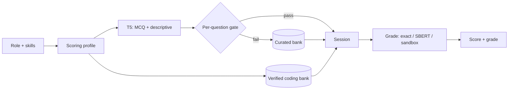

| | |
|---|---|
| **Component** | 02 — AI Interview |
| **Service** | FastAPI on `:8002` |
| **Models** | T5 (12,161,536 params) · SBERT `all-mpnet-base-v2` |
| **Store** | MongoDB `recruit_ai` |

> **Generate and grade a candidate's full interview profile — MCQ, descriptive and coding — instead of a single isolated question.**

## How it works

- **Builds the mix from the role, not a template.** Every session takes the role's scoring profile, so the MCQ / descriptive / coding counts match how that role is actually graded. Non-coding roles get zero coding questions.
- **Generates MCQ and descriptive with a 12.16 M-parameter T5** trained from scratch, then gates each question on its own. 42 of 100 generated questions pass. A rejected question is replaced from the curated bank; a role is never rejected.
- **Never invents a coding answer key.** Coding comes from a verified bank: 262 Python questions proven by execution, 483 non-executed questions across six languages with keys authored by construction, and 40 SQL questions proven against SQLite.
- **Grades three ways.** MCQ by exact match; descriptive by SBERT cosine similarity plus keyword coverage; code by running it in a hardened container — no network, read-only filesystem, non-root user, 8 s, 256 MB, 1 CPU.

<br>

| **20**<br>job roles, end to end | **785**<br>verified coding questions | **42%**<br>per-question gate pass rate |
|:---:|:---:|:---:|

## Measured results

Per-question gate, 20 roles × 5 generated questions (`models/t5_qg_gate_report.txt`):

| Measurement | Result |
|---|---|
| Generated questions passing the gate | 42 / 100 (42%) |
| Roles serving at least one model question | 18 / 20 |
| Model questions in 20 × 10-question sessions | 32 / 200 (16%) |
| Roles filled to a complete 10-question session | 20 / 20 |
| Tests | 138 passed, 4 skipped (Docker-only) |

Model quality on the held-out 400-row slice (`models/t5_qg_eval.md`):

| Metric | Value |
|---|---|
| BLEU-4 | 10.93 |
| ROUGE-L F1 | 21.53 |
| Field-valid output | 61.25% |

The generator is deliberately allowed to be weak: the gate plus per-slot bank fallback is what keeps a weak batch from degrading an interview.

## Question mix

| Type | Source | Grading |
|---|---|---|
| MCQ | T5 → bank fallback | Exact match |
| Descriptive | T5 → bank fallback | SBERT cosine + keyword coverage |
| Coding | Verified bank only | Test-case pass rate in the sandbox |

## Pipeline



## Quick start

```bash
cd component2/backend
pip install -r requirements.txt
uvicorn main:app --host 0.0.0.0 --port 8002
```

- Health: `GET /health`
- API docs: `http://localhost:8002/docs`

The interview UI lives in the unified frontend (`frontend/`), not in this folder. From the repository root, `python start_all.py` brings up all five services and the UI.

With a local MongoDB, `.env` needs:

```env
MONGODB_URI=mongodb://localhost:27017
DB_NAME=recruit_ai
```

## API

| Method | Path | Purpose |
|---|---|---|
| POST | `/api/v1/interview/start` | Create a role-specific session |
| GET | `/api/v1/interview/session/{session_id}` | Fetch session questions |
| POST | `/api/v1/interview/submit` | Submit answers and receive scores |
| POST | `/api/v1/interview/code/run` | Run candidate code in the sandbox |
| GET | `/api/v1/interview/result/{interview_id}` | Fetch a stored result |
| GET | `/api/v1/interview/jobs` | List the 20 supported roles |

## Model and data

- T5 seq2seq, 12,161,536 params, trained from scratch on `models/qg_dataset_v2.json` (4,996 train / 556 validation).
- Runtime prefers `models/t5_qg`; the curated bank backs every slot the gate rejects.
- Role profiles and language policy: `backend/services/role_profiles.py`, `models/role_coding_languages.md`.
- Coding banks and builders: `models/coding_bank_*.json`, `ml/build_sql_bank.py`.
- Python bank sources: humaneval-x and lbpp (Apache-2.0), 163 + 101 questions, each key re-executed and verified.

## Design notes

- Candidate code execution is **Python-only by design**; no additional language runtimes are installed. Other languages use non-executed formats (Predict Output / Find the Bug / Complete Function) whose keys can be proven without running code.
- The sandbox is a security boundary: `CODE_SANDBOX=docker` is required before any public deployment. Without a Docker daemon it degrades to `subprocess` and logs a warning.
- Answer keys are never model-generated.

## Documentation

- [`README_TECHNICAL.md`](README_TECHNICAL.md) — full architecture, setup and integration notes
- [`models/t5_qg_eval.md`](models/t5_qg_eval.md) — generation metrics
- [`models/t5_qg_gate_report.txt`](models/t5_qg_gate_report.txt) — 20-role gate measurement
- [`models/t5_coding_diagnosis.md`](models/t5_coding_diagnosis.md) — why coding collapses in T5 and the fix
- [`models/role_skills_report.md`](models/role_skills_report.md) — real job-posting skill coverage
- [`backend/sandbox/README.md`](backend/sandbox/README.md) — container hardening details
